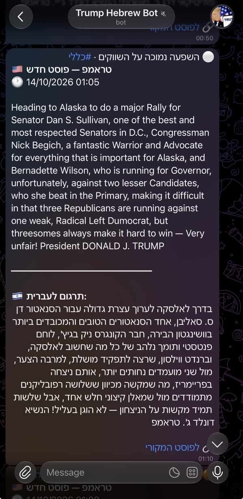
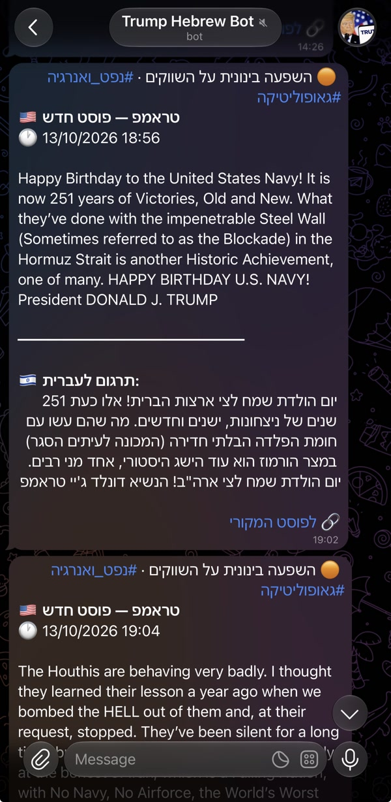
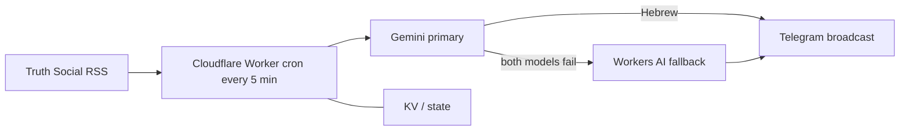

# Trump Truth Social → Hebrew Telegram

[](https://github.com/aviniazov7/trump-telegram-bot/actions/workflows/tests.yml)
[](https://www.typescriptlang.org/)
[](https://developers.cloudflare.com/workers/)
[](https://github.com/aviniazov7/trump-telegram-bot/actions/workflows/tests.yml)
[](https://github.com/aviniazov7/trump-telegram-bot/actions/workflows/tests.yml)

Hebrew broadcasts of Donald Trump's Truth Social posts, tagged by likely market impact, on Telegram within minutes of publication. Live bot: [t.me/TrumpHebrewBot](https://t.me/TrumpHebrewBot).

Built by [Avraham Niazov](https://github.com/aviniazov7).

## What it does

Every five minutes a Cloudflare Worker reads new posts, translates them into Hebrew, labels the likely market impact, and sends one message to every subscriber. A Telegram webhook handles `/start`, `/stop`, and `/trumphere`.

A message leads with an impact line and Hebrew topic tags (tariffs, the Fed, oil and energy, geopolitics, crypto, China, stocks), then the original text, the translation, and a link to the post. High-impact posts go out ahead of the backlog. The cron has been in production since 12 October 2026.

<table>
  <tr>
    <td></td>
    <td></td>
  </tr>
</table>

Medium market impact on a Navy and Houthis post (oil and geopolitics), and a Hebrew translation of an Alaska rally post.

## Architecture



Truth Social's own API and RSS answer 403, so the Worker reads the trumpstruth.org feed (cache-busted) and merges the newest posts from the CNN archive. Gemini is primary: `gemini-3.8-flash`, then `gemini-3.5-flash-lite` when that model fails or its free daily quota is used up. Workers AI (`@cf/zai-org/glm-4.7-flash`) translates only after both Gemini models fail. Subscribers, the cursor, and cached translations live in Workers KV. A Durable Object holds the run lease and per-chat send claims, because KV is eventually consistent and a cron can start twice.

## Key engineering decisions

**Translation fallback chain.** One Gemini call returns Hebrew plus schema-checked topics and impact. The primary model is `gemini-3.8-flash`; `gemini-3.5-flash-lite` runs only when that call fails or the free daily quota is used up. If a translation contains Arabic script, the fallback model is asked again with stricter instructions, and any Arabic characters that remain are repaired or stripped. Keyless translators (Google, Lingva, MyMemory) are blocked from Cloudflare's network, so they are not in the chain. When both Gemini models fail — a daily quota error, any other error, or an answer that is still English — the Worker makes one Workers AI call with reasoning off and a capped completion, which keeps the fallback inside the free plan's 10,000 neurons per day. Keyword rules still set the topics. Tariffs, the Fed, oil and energy, and geopolitics are never tagged below medium, including when Gemini is down. Only Gemini can mark a post high impact. If Workers AI also fails to return Hebrew, the post goes out in English with a notice.

**429 and quota handling.** A per-minute Gemini 429 is waited out, and only inside the run's time budget. A per-day 429 is stored in KV until midnight Pacific, and that model is not called again. If every Gemini model is out of daily quota, the same run uses Workers AI instead of waiting. With Workers AI disabled, the post goes out in English immediately and the admin gets one quota alert. Telegram 429s wait `retry_after` for up to 10 seconds; a longer wait resumes on the next cron and is never treated as delivered. Timeouts and 5xx responses are recorded as uncertain and are not resent, because the message may already have arrived.

**Idempotent, resumable broadcast.** Each chat is claimed in the Durable Object before the send. A chat with any claim never receives that post again, including a claim from an overlapping run. If the claim cannot be written, nothing is sent. KV mirrors the claim; if that mirror fails, the claim still stands, so delivery is at most once. A run that stops mid-broadcast resumes from the claim log, and the cached analysis is reused so the text matches. Any KV write failure stops further sends until writes work again.

**Skipping content-less reposts and caption-less videos.** A boost whose only text is `RT @user` or `Reposted <name>`, or a wordless re-post of a status already in the window, is not translated or broadcast. A single image or video with no caption is skipped. Two or more caption-less posts that are ready in the same run become one digest of links, and that set is fixed before the send so a retry cannot deliver them again.

**PII-safe logs.** Logs never contain the bot token, API keys, or raw chat IDs. A chat id is logged as `chat#` plus ten hex characters of an HMAC keyed by the bot token. Token-shaped strings are scrubbed. The Gemini key travels in a request header. Tests fail if a secret or a raw chat id reaches a log line. The webhook path is a hash of the secret, and Telegram's secret header is compared in constant time. A bad request looks like any other 404.

**Time and subrequest budgets.** The free plan allows 50 subrequests per invocation. Each run stops starting new work after 45 subrequests and 90 seconds. Whatever is left continues five minutes later. Admin alerts ignore the time budget and still respect the subrequest cap. Each Gemini call is capped at 12 seconds, with 8 seconds kept back for sending.

## Tech stack

| | |
|---|---|
| Runtime | Cloudflare Workers, Cron Trigger `*/5 * * * *`, Workers AI |
| Language | TypeScript 5.9 |
| State | Workers KV and a SQLite-backed Durable Object (`Coordinator`) |
| Translation | Gemini API, with a Workers AI fallback (`@cf/zai-org/glm-4.7-flash`) |
| Delivery | Telegram Bot API |
| Tests | Vitest 4 on the Workers runtime (`@cloudflare/vitest-plugin`) |
| Lint | Biome and `tsc` |
| Tooling | Wrangler 4, Node 22 in CI |

## Testing

```bash
npm test            # 201 tests, workerd, local KV, no network
npm run coverage    # line-coverage gate is 85%
```

`npm test` and `npm run coverage` on 14 October 2026: **201 passed**, **95.39%** lines (statements 92.51%, functions 95.40%, branches 83.37%). The [tests workflow](.github/workflows/tests.yml) also lints, typechecks, scans for secrets, and dry-runs the bundle. Its coverage badge reports the floored line percentage (95% at this measurement). Outbound calls in tests go through an injected `fetch`.

The suites cover post filtering and the two sources, idempotent and resumable sends, Telegram error mapping, webhook authentication, Gemini and Workers AI fallbacks, daily quota, caption-less media, and log redaction. The file-by-file map is in [docs/operations.md](docs/operations.md#development).

## Quick start

```bash
npm ci
npm test
cp .dev.vars.example .dev.vars   # placeholders only
npm run dev                      # cron: curl "http://localhost:8787/__scheduled"
```

Deploy needs Node 22, a Cloudflare account, a token from [@BotFather](https://t.me/BotFather), and a [Gemini key](https://aistudio.google.com/apikey). Create the KV namespace, set secrets with `npx wrangler secret put`, and deploy with `npx wrangler deploy`. Start a new install with `DRY_RUN = "true"` so only the admin receives previews. The committed config is the live bot (`DRY_RUN = "false"`).

Production deploys from `main` wait for a required reviewer. See [Deploy from GitHub](docs/configuration.md#optional-deploy-from-github).

## Documentation

- [Operations](docs/operations.md) — run shape, fallback rules, monitoring, KV layout, security, [setup](docs/operations.md#setup), [cutover](docs/operations.md#cutover), and [rollback](docs/operations.md#rollback)
- [Configuration](docs/configuration.md) — secrets, vars, the Workers AI binding, and [deploy from GitHub](docs/configuration.md#optional-deploy-from-github)
- [Cloudflare migration proposal](docs/CLOUDFLARE_MIGRATION.md) — why the GitHub Actions cron was replaced (implemented)
- [History cleanup](docs/HISTORY_CLEANUP.md) — removing old state files from git history
